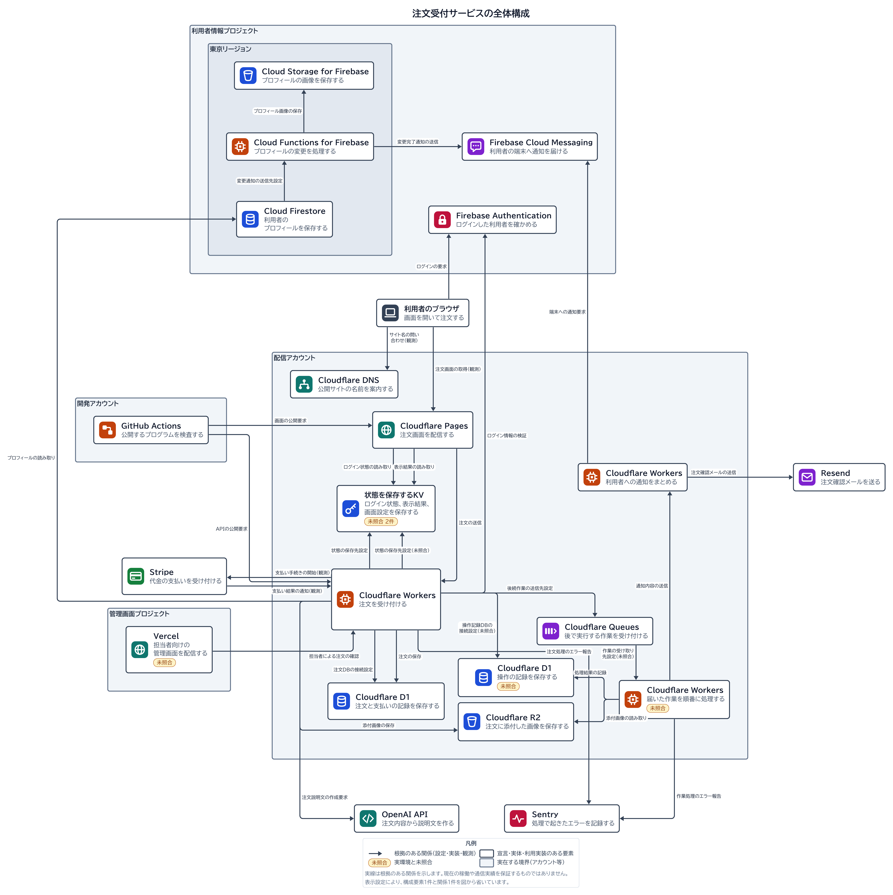

<div align="center">

# ponchimap

アプリが使うクラウドのサービスとその関係を、根拠付きの構成図にするツールです。<br>
コーディングエージェントが同梱の Skill に従ってリポジトリ・資料・実環境を調べ、ponchimap の CLI が図とレポートを生成します。

<a href="docs/images/order-service.png"></a>

*架空の注文受付サービスを描いた構成図の例*

</div>

## 特徴

- **すべての要素に根拠が残る**: 図の箱と線には、設定ファイルの宣言・実装・資料の記述・サービスの CLI による実環境照会のどれを根拠にしたかが記録され、レポートで確認できます。
- **確かさの度合いが図で分かる**: 根拠の状態に応じて図の表現が変わります。
  - **「未照合」の印**: 設定ファイルに書いてあるだけで、実環境と照合していない要素
  - **「不一致」の印**: 複数の根拠どうしで値が食い違っている要素
  - **破線**: 資料や手がかりにしか出てこない要素
- **特定のクラウドに依存しない**: ponchimap の Skill と CLI はサービス固有の知識を持ちません。設定ファイルの読み方や照会コマンドは、エージェントが各サービスの CLI ヘルプと公式資料で確かめます。

## はじめる

### 1. CLI をインストールする

Go 1.27.4 以降が必要です。

```bash
go install github.com/ochamu/ponchimap/cmd/ponchimap@latest
```

`go install` は `ponchimap` を Go の bin フォルダ（通常 `~/go/bin`）に配置します。エージェントも PATH から `ponchimap` を探すため、このフォルダを PATH に通しておいてください。

### 2. 構成図を描きたいフォルダで初期化する

対象のアプリのフォルダで `ponchimap init` を実行します。

```bash
ponchimap init
```

> [!TIP]
> 複数のリポジトリで使う場合は、[プラグインとして入れる](#プラグインとして入れる)と事前の `ponchimap init` を省略できます。

### 3. エージェントに依頼する

そのフォルダで Claude Code や Codex などのエージェントを起動し、次のように頼みます。

```text
このリポジトリの構成図を作って
```

Skill を明示して頼む場合は、依頼の先頭に **Claude Code では `/ponchimap`**、**Codex では `$ponchimap`** を付けます。

#### 実行の流れ

1. **調査**: `init` が配置した Skill に従い、設定ファイル・コード・資料を読み、必要に応じてサービスの CLI で実環境を照会します。
   - 環境が複数あって依頼で指定されていない場合は、どの環境を描くかを尋ねます。
   - サービスの CLI のサインイン先が対象アカウントと合わないときも、照会の前に尋ねます。
2. **出力**: 調べた結果を調査入力（JSON）に書き出し、ponchimap の CLI で構成図とレポートを生成します。
3. **報告**: 図とレポートの場所、主な要素の役割、確かめられなかった点とその理由を答えます。

**構成図を更新したいとき**: もう一度同じように頼むと、エージェントは前回の調査入力を読んだうえでリポジトリと資料を調べ直し、同じ要素を同じ ID のまま更新します。`architecture.view.yaml` に書いた表示名やグループもそのまま残ります。

### プラグインとして入れる

プラグインを一度入れておくと、まだ `ponchimap init` を実行していないアプリのフォルダでも、Claude Code や Codex に直接構成図を頼めます（CLI のインストールは事前に必要です）。

#### インストール

**Claude Code**

```bash
claude plugin install ponchimap --marketplace ochamu/ponchimap
```

**Codex**

```bash
codex plugin marketplace add ochamu/ponchimap
codex plugin add ponchimap@ponchimap
```

#### 使い方

インストール後にエージェントを起動し、依頼の先頭に **Claude Code では `/ponchimap:ponchimap`**、**Codex では `$ponchimap:ponchimap`** を付けて頼みます。

エージェントは指定したアプリのフォルダ（未指定なら現在の作業フォルダ）で `ponchimap init` を実行し、そのまま調査と描画を続けます。

> [!NOTE]
> **既存の Skill がある場合**: `init` は同梱の Skill と参照ファイルのうちフォルダにないものだけを追加します。既存ファイルの内容が同梱版と異なる場合は上書きせず残して警告し、エージェントはその警告を伝えたうえでフォルダ内の手順と参照ファイルに従います。

## 見本で試す

リポジトリに同梱されている見本を使って、動作を手元で試せます。

### CLI だけで試す（エージェント・クラウド不要）

手で書いた調査入力の見本（設定ファイルの読み取り結果とクラウド照会結果を架空の値で記述したもの）を取り込んで描画します。ponchimap のコマンドはどれもネットワークを使いません。

```bash
git clone https://github.com/ochamu/ponchimap.git ~/ponchimap
mkdir -p ~/ponchimap-demo && cd ~/ponchimap-demo
ponchimap init
cp ~/ponchimap/examples/first-run/findings/*.json .ponchimap/findings/
ponchimap import && ponchimap lint && ponchimap render
```

実行後、`docs/architecture/overview.png` に [examples/first-run/overview.png](examples/first-run/overview.png) と同じ図が生成されます。

### エージェントで試す（見本アプリ）

見本アプリ `examples/memo-app` を使って、エージェントの調査から描画までを試せます（先に上の `git clone` で `~/ponchimap` を取得しておきます）。

1. 見本アプリを `~/ponchimap` の外にコピーし、`git init` と `ponchimap init` を実行します。

   ```bash
   cp -r ~/ponchimap/examples/memo-app ~/memo-app-demo
   cd ~/memo-app-demo
   git init
   ponchimap init
   ```

2. エージェントを起動し、**「クラウドへの照会はしないで」** と添えて構成図の作成を頼みます（見本アプリの識別子は架空の値のため）。
   - 見本には `dev` と `production` の 2 つの環境があり、どちらを描いてもかまいません。

## できるもの

| ファイル | 中身 |
|---|---|
| `docs/architecture/overview.svg`<br>`docs/architecture/overview.png` | 構成図（SVG / PNG） |
| `.ponchimap/report.md` | 要素ごとの役割、根拠、確かめられなかった点のレポート |
| `architecture.view.yaml` | 表示設定（題、表示名、グループ、配置などの見せ方） |
| `.ponchimap/` | 作業領域（調査入力 `findings/`、モデル、取り込みの記録） |

## 図を整える

### 見せ方を変える

エージェントに「この2つを『バックエンド』という枠でまとめて」のように頼むか、`architecture.view.yaml` を編集して `ponchimap render` を実行します。表示設定は見た目だけを変え、根拠は変えません。

### 配置を調整する

配置が読みにくいときは、配置エンジンや向き、seed を変えて描き直せます。気に入った配置を続けて使うには、`architecture.view.yaml` の `layout` に書きます。

配置エンジンを ELK に替え、上から下へ並べるには次のコマンドを実行します。

```bash
ponchimap render --engine elk --direction down
```

既定の配置エンジン（TALA）で配置の seed を引き直すには次のコマンドを実行します（要素の少ない図は seed を変えても同じ図になることがあります）。

```bash
ponchimap render --reroll
```

## 安全のために

- **読み取り専用での調査**: Skill はエージェントに対し、読み取りのコマンドだけを実行するよう指示しています。実行前には、コマンドが読み取り専用であることと、出力に資格情報や秘密の値が載らないことを、ヘルプか公式資料で確かめさせます。デプロイ・作成・削除・サインイン・CLI のインストールはしない指示になっています。
- **作業領域は Git 管理から除外**: `.ponchimap/` は、`init` が `.gitignore` に加える行で Git の追跡対象から外れます。図・表示設定・Skill のフォルダは作業領域の外にあり、コミットするかどうかは利用者が選べます。

> [!WARNING]
> **共有する前に確認してください**
> - **レポートはそのまま共有しない**: `.ponchimap/report.md` はアカウント ID などの識別子の値を含みます。手元で読むための記録として扱ってください。
> - **図の内容を確認してから共有する**: 構成図には、調査入力に書いた役割や関係の説明がそのまま出ます。識別子や秘密の値を書いていないかを、共有する前に図で確かめてください。

## 詳しい資料

- [docs/reference.md](docs/reference.md) — 利用者補足、表示設定、終了コード、診断の読み方
- [skills/ponchimap/SKILL.md](skills/ponchimap/SKILL.md) — エージェントが従う手順（英語）
- [skills/ponchimap/references/findings.md](skills/ponchimap/references/findings.md) — 調査入力の書き方（英語、スキーマは [schema/](schema/)）

## ライセンス

- **ponchimap 本体**: [Apache License 2.0](LICENSE)
- **同梱フォント（BIZ UDPGothic）**: SIL Open Font License 1.1
- **依存モジュール**: [docs/reference.md](docs/reference.md#ライセンス) を参照
