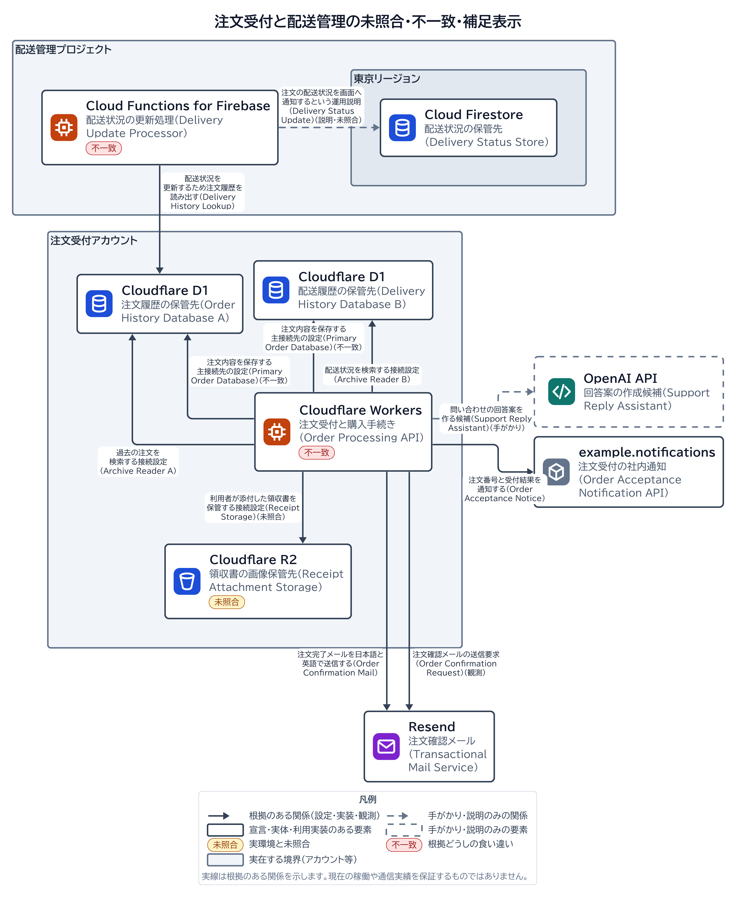
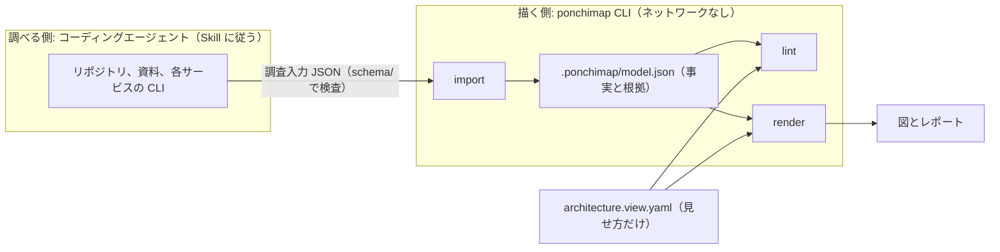

<div align="center">

# ponchimap

アプリが使うクラウドのサービスとその関係を、根拠付きの構成図にするツールです。<br>
コーディングエージェントが同梱の Skill に従ってリポジトリ・資料・実環境を調べ、ponchimap の CLI が図とレポートを生成します。

<a href="docs/images/order-service.png"></a>

*架空の注文受付サービスを描いた構成図の例*

</div>

## 特徴

エージェントに構成図を直接描かせると、推測と確かめた事実が混ざり、実環境とのずれが見えず、描き直すたびに図が変わります。ponchimap は調べる作業だけをエージェントに任せ、調査入力の取り込み、検査、描画は Go の CLI が受け持ちます。同じ状態のモデルに同じ調査入力と同じ設定を与えれば、同じ図とレポートが出ます。

- **すべての要素に根拠が残る**: 図のカードと線ごとに、設定ファイルの宣言、実装、資料の記述、実環境の照会結果のどれを根拠にしたかを記録し、レポートで確認できます。
- **確かさの度合いが図で分かる**: 設定にあるだけで実環境と照合していない要素には「未照合」、根拠どうしで値が食い違う要素には「不一致」の印が付き、資料や手がかりにしか出てこない要素は破線になります。
- **特定のクラウドに依存しない**: Skill と CLI は、サービスごとの設定の読み方や照会コマンドを持ちません。エージェントが各サービスの CLI ヘルプと公式資料で確かめます。

### 不一致を図とレポートで見る

見本 [testdata/samples/long-labels-and-mismatches](testdata/samples/long-labels-and-mismatches/) では、Cloudflare Workers の設定項目 `DB_PRIMARY` の接続先が、`wrangler.toml` の宣言と実環境の照会結果で違います。図ではそのカードに「不一致」の印が付き、2本の線のラベルの末尾に「（不一致）」が付きます。実環境と照合していない Cloudflare R2 には「未照合」の印が付き、`package.json` の記述だけが手がかりの OpenAI API は破線で描かれます。

<a href="docs/images/long-labels-and-mismatches.png"></a>

<details>
<summary>同じ見本から生成したレポートの「食い違い」の抜粋（リンクとエスケープの記号は省略）</summary>

```markdown
- 不一致: n301 Cloudflare Workers、e301 接続設定（n301 → n302）、e302 接続設定（n301 → n303）。設定項目（slot）「DB_PRIMARY」の接続先が根拠によって違う
  - ev315: e301 接続設定（n301 → n302）の設定上の宣言（declared）。`connection.configured = true`、`connection.target = "n302"`。出典 file `wrangler.toml` 10〜16行。確認時刻 2026-11-13T09:05:00Z。対象時点 2026-11-13T09:00:00Z
  - ev316: e302 接続設定（n301 → n303）の実環境で確認（deployed）。`connection.configured = true`、`connection.target = "n303"`。出典 query `findings/long-labels-and-mismatches/primary-binding.json`。確認時刻 2026-11-13T09:05:00Z。対象時点 2026-11-13T09:00:00Z
  - この項目に当たる調査範囲: cv303 完了（complete）。DB_PRIMARYの単一接続先だけを対象時点で取得完了。実環境の接続先はn303
```

</details>

## しくみ



- **スキーマを境に調査と描画を分ける**: 変わりやすいサービスの設定や照会コマンドは、エージェントが公式資料とヘルプで調べます。CLI に書けば古くなるので、CLI は [schema/](schema/) で検査した調査入力を取り込むだけです。
- **事実と見せ方を分け、未照合を隠さない**: `.ponchimap/model.json` が事実と根拠を持ち、`architecture.view.yaml` は見せ方だけを変えます。[根拠の評価](internal/view/assess.go)は表示設定を受け取らず、まとめたカードは印を引き継ぎ、隠した要素の未照合と不一致は件数が図の注記に残ります。
- **検査は1か所、ID は変わらない**: 検査は `lint` に集め、`import` も `render` もエラーのあるモデルを通しません。ID は主キーのハッシュから作り、再調査では[4段階の主キー](internal/importer/doc.go)で同じ要素を見つけて ID を引き継ぐので、表示設定が外れません。
- **描画エンジンを隔離し、同じ図を再現する**: D2 を import するのは `internal/render/d2render` だけで、境界のテストがそれを強制します。禁則を守る折り返し、同梱フォントでの幅の計測、PNG の描画までプロセス内で行い、同じ入力からバイト単位で同じ図を作ります。
- **診断に入力の値を出さない**: JSON、YAML、スキーマのライブラリのエラー文は入力を引用するので使いません。場所（ファイル、行、JSON Pointer）、固定のコード、自前の文だけを返し、識別子や秘密の値が診断文に載らないようにしています。

## はじめる

### 1. CLI を入れる

- **ビルド済みバイナリ（Go 不要）**: [GitHub Releases](https://github.com/ochamu/ponchimap/releases) に公開されている環境用のアーカイブ（macOS・Linux は `amd64` / `arm64` の `.tar.gz`、Windows は `amd64` の `.zip`、検証用ハッシュは `SHA256SUMS.txt`）を展開し、`ponchimap`（Windows は `ponchimap.exe`）を PATH の通ったフォルダに置きます。
- **Go でビルド（Go 1.27.4 以降）**: リリース公開前やソースから入れる場合は次を実行し、Go の bin フォルダ（通常 `~/go/bin`）を PATH に通します。

```bash
go install github.com/ochamu/ponchimap/cmd/ponchimap@latest
```

### 2. エージェントに頼む

対象のアプリのフォルダ（Git リポジトリ）で `ponchimap init` を実行し、Claude Code や Codex に「このリポジトリの構成図を作って」と頼みます（Skill を明示する場合は Claude Code で `/ponchimap`、Codex で `$ponchimap` を先頭に付けます）。

```bash
ponchimap init
```

複数環境の選択やサインイン先アカウントの不一致があるときは照会前に確認し、完了後に図とレポートの場所・主な役割・未確認の点と理由を答えます。更新するときも同じように頼めば、表示名やグループを保ったまま描き直せます。

### プラグインとして入れる

プラグインを入れておくと事前の `ponchimap init` が不要になり、エージェントが対象フォルダで初期化から調査・描画まで進めます（CLI の導入は必要です）。依頼の先頭には Claude Code で `/ponchimap:ponchimap`、Codex で `$ponchimap:ponchimap` を付けます。

```bash
# Claude Code
claude plugin install ponchimap --marketplace ochamu/ponchimap

# Codex
codex plugin marketplace add ochamu/ponchimap
codex plugin add ponchimap@ponchimap
```

## 見本で試す

### CLI だけで試す

エージェントもクラウドのアカウントも要りません。手で書いた調査入力の見本（値は架空）を取り込んで描きます。

```bash
git clone https://github.com/ochamu/ponchimap.git ~/ponchimap
mkdir -p ~/ponchimap-demo && cd ~/ponchimap-demo
ponchimap init
cp ~/ponchimap/examples/first-run/findings/*.json .ponchimap/findings/
ponchimap import && ponchimap lint && ponchimap render
```

`lint` が `0 errors, 0 warnings` と表示し、`docs/architecture/overview.png` に [examples/first-run/overview.png](examples/first-run/overview.png) と同じ図ができます。

### エージェントで試す

見本アプリ `examples/memo-app` を `~/ponchimap` の外にコピーし、そこでエージェントに構成図を頼みます。見本の識別子は架空なので、「クラウドへの照会はしないで」と添えます。環境は `dev` と `production` の2つがあり、どちらを描いてもかまいません。

```bash
cp -r ~/ponchimap/examples/memo-app ~/memo-app-demo && cd ~/memo-app-demo
git init && ponchimap init
```

## できるもの

| ファイル | 中身 |
|---|---|
| `docs/architecture/overview.svg`<br>`docs/architecture/overview.png` | 構成図 |
| `.ponchimap/report.md` | 要素ごとの役割、根拠、確かめられなかった点のレポート |
| `architecture.view.yaml` | 表示設定（題、表示名、グループ、配置などの見せ方） |
| `.ponchimap/` | 作業領域（調査入力 `findings/`、モデル、取り込みの記録） |

図の凡例と印、レポートの定型文は日本語で、CLI の診断は英語です。エージェントは利用者の言語で答えます。

## 図を整える

エージェントに「この2つを『バックエンド』という枠でまとめて」のように頼むか、`architecture.view.yaml` を編集して `ponchimap render` を実行します。

配置が読みにくいときは、配置エンジン、向き、seed を変えて描き直せます。気に入った配置を使い続けるには、`architecture.view.yaml` の `layout` に書きます。

```bash
ponchimap render --engine elk --direction down   # 配置エンジンを ELK に替え、上から下へ並べる
ponchimap render --reroll                        # 既定の TALA のまま、seed を引き直す
```

## 安全のために

- **調査は読み取り専用**: Skill は読み取りコマンドだけを実行し、実行前に読み取り専用であることと秘密値が出力されないことをヘルプか公式資料で確かめるよう指示します。デプロイ、作成、削除、サインイン、CLI のインストールはしない指示です。
- **CLI は通信しない**: フォント、アイコン、スキーマを同梱し、PNG もプロセス内で描きます。CI ではネットワークを遮断した環境で `init` から `render` まで検証しています。
- **作業領域は Git 管理から除外**: `init` が `.gitignore` に除外行を加え、`.ponchimap/` を追跡対象から外します（すでに追跡中のファイルや `.gitignore` を更新できない場合は警告します）。図、表示設定、Skill は作業領域の外にあり、コミットするかどうかを選べます。

> [!WARNING]
> **共有する前に確認してください。** `.ponchimap/report.md` はアカウント ID などの識別子を含むため、手元で読む記録として扱ってください。構成図にも役割や関係の説明がそのまま出るため、共有前に識別子や秘密値が含まれていないか図で確かめてください。

## 詳しい資料

- [docs/reference.md](docs/reference.md) — 利用者補足、表示設定、PNG の出力条件、終了コード、診断の読み方
- [SECURITY.md](SECURITY.md) — 脆弱性の報告先
- [skills/ponchimap/SKILL.md](skills/ponchimap/SKILL.md) — エージェントが従う手順（英語）
- [skills/ponchimap/references/findings.md](skills/ponchimap/references/findings.md) — 調査入力の書き方（英語、スキーマは [schema/](schema/)）

## ライセンス

ponchimap 本体は [Apache License 2.0](LICENSE)、同梱フォント（BIZ UDPGothic）は SIL Open Font License 1.1 です。依存モジュールのライセンスは [docs/reference.md](docs/reference.md#ライセンス) を参照してください。
